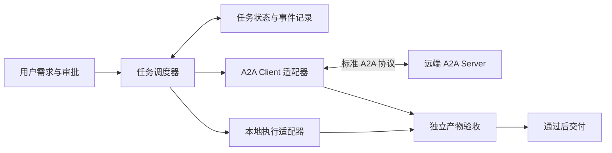

# A2A

面向 Agent2Agent 协议的学习、互通实验与可靠任务编排项目。

> 当前状态：仓库初始化，包含目标架构与参考资料。尚未提供可运行的 A2A Client / Server，也未完成协议兼容性验证。

## 目标

- 使用官方 SDK 建立独立 Agent 之间的通信。
- 将内部任务调度与 A2A 协议适配分开，支持本地与远端执行。
- 将执行完成、产物验收与最终交付分别记录。
- 逐步验证取消、失败恢复、重复提交与人工介入的行为。

## 目标架构

以下为设计目标，各运行组件尚未实现。

A2A 是 Agent 互通协议；任务规划、审批、调度与验收由应用实现。远端任务返回 `completed` 后，内部任务仍需经过验收。

## 阅读入口

- [架构与实现路线](docs/architecture.md)
- [相关 GitHub 仓库](docs/related-repositories.md)
- [官方协议文档](https://a2a-protocol.org/latest/specification/)

## 实现路线

1. 选定并固定协议版本及官方 SDK 版本，完成最小客户端 / 服务端通信。
2. 增加任务持久化、本地与远端执行适配器及独立验收。
3. 验证取消、断线恢复、重试和人工补充输入。
4. 按选定版本进行互通测试，再考虑服务部署。

当前没有运行依赖、CI 工作流或部署配置。
